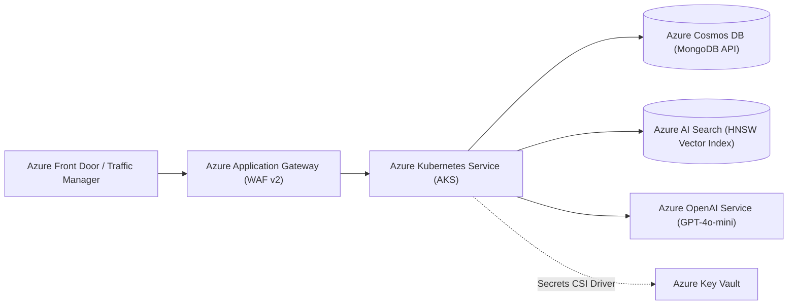

# Public Cloud Deployment Architecture — Azure, AWS, and GCP

MealMate.ai is designed following cloud-native Twelve-Factor App principles and can be deployed across major public cloud providers.

---

## 1. Microsoft Azure Reference Architecture



### Azure Services Mapping

| Component | Azure Service | Tier / SKU | Configuration & Notes |
| :--- | :--- | :--- | :--- |
| **Container Orchestration** | Azure Kubernetes Service (AKS) | Standard (System + User Node Pool) | Multi-zone cluster with Horizontal Pod Autoscaler (HPA) and Azure CNI. |
| **Serverless Alternative** | Azure Container Apps (ACA) | Consumption / Dedicated | Ideal for low-maintenance deployments with KEDA scaling on HTTP concurrency. |
| **Document Database** | Azure Cosmos DB | MongoDB vCore / RU-based | Geographically replicated with automated continuous backups. |
| **Vector Search Engine** | Azure AI Search | Standard S1 | HNSW vector configuration with cosine metric, integrated with `AzureAISearchClient`. |
| **LLM Provider** | Azure OpenAI Service | Standard | Deployment of `gpt-4o-mini` with provisioned rate limits and private endpoint connectivity. |
| **Secret Management** | Azure Key Vault | Standard | Integrated via Secrets Store CSI Driver to mount secrets as Kubernetes volumes. |
| **CI/CD & Registries** | Azure Container Registry (ACR) | Premium | Geo-replicated registry integrated with GitHub Actions Workflows. |

### Azure CLI Deployment Commands

```bash
# 1. Create Resource Group & AKS Cluster
az group create --name rg-mealmate-prod --location eastus
az aks create \
  --resource-group rg-mealmate-prod \
  --name aks-mealmate \
  --node-count 3 \
  --enable-cluster-autoscaler \
  --min-count 2 \
  --max-count 8 \
  --enable-managed-identity \
  --generate-ssh-keys

# 2. Deploy Azure AI Search Service
az search service create \
  --name mealmate-search \
  --resource-group rg-mealmate-prod \
  --sku Standard \
  --partition-count 1 \
  --replica-count 1

# 3. Apply Kubernetes Manifests via Kustomize
kubectl apply -k k8s/
```

---

## 2. Amazon Web Services (AWS) Reference Architecture

| Component | AWS Service | Purpose |
| :--- | :--- | :--- |
| **Orchestration** | Amazon EKS (Elastic Kubernetes Service) | Managed Kubernetes cluster spanning 3 Availability Zones. |
| **Database** | Amazon DocumentDB | MongoDB-compatible managed database with automated failover. |
| **Vector Search** | Amazon OpenSearch Service | Vector database engine with k-NN search plugin. |
| **Container Registry** | Amazon ECR | Private Docker image registry with vulnerability scanning. |
| **Secrets & Keys** | AWS Secrets Manager | Automated secret rotation and parameter storage. |

---

## 3. Google Cloud Platform (GCP) Reference Architecture

| Component | GCP Service | Purpose |
| :--- | :--- | :--- |
| **Orchestration** | Google Kubernetes Engine (GKE) | Autopilot or Standard cluster with node auto-provisioning. |
| **Alternative** | Google Cloud Run | Fully managed serverless container runtime. |
| **Database** | MongoDB Atlas on GCP / Cloud Firestore | High-availability document database. |
| **LLM & Embeddings** | Google Vertex AI / Gemini API | Native integration using `gemini-1.5-flash` and `text-embedding-004`. |
| **Observability** | Cloud Monitoring & Cloud Logging | Prometheus-compatible managed service for metrics. |

