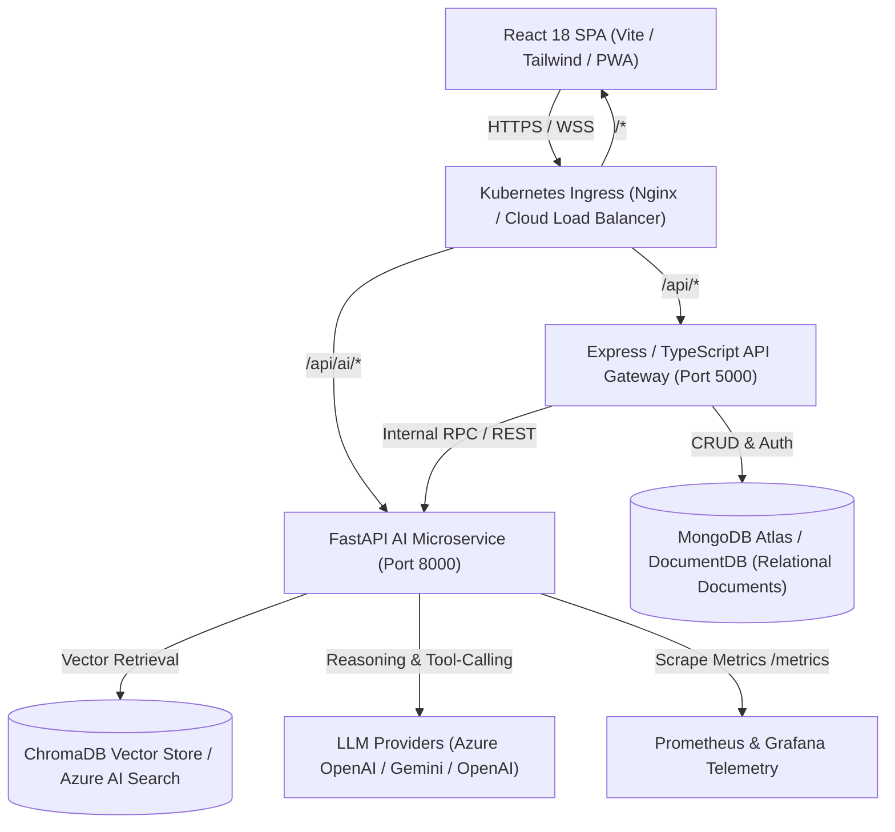
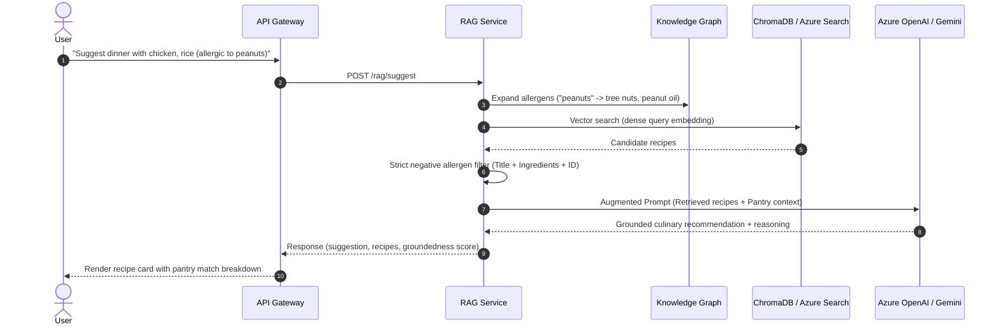

# MealMate.ai — Enterprise System Architecture & Design

This document details the production architecture, distributed system topology, machine learning pipelines, and cloud-native infrastructure for MealMate.ai.

---

## 1. System Topology & Distributed Components

### Component Roles & Responsibilities

1. **Client Tier (`client/`)**:
   - React 18 single-page application built with Vite and Tailwind CSS.
   - PWA caching for offline access, camera capture for fridge/pantry computer vision scans.
   - Real-time meal plan adjustments, ingredient substitutions modal, interactive agent assistant.

2. **API Gateway / Core Backend (`server/`)**:
   - Node.js 20 + Express written in strict TypeScript.
   - Handles user authentication (JWT + bcrypt), authorization, MongoDB data persistence.
   - Acts as the orchestration orchestrator coordinating between user meal plans, grocery lists, and AI service inferences.
   - Implements circuit breaking and fallback logic if AI microservice is temporarily degraded.

3. **AI & ML Microservice (`ai-service/`)**:
   - Python 3.12 + FastAPI asynchronously serving low-latency ML inferences.
   - **Hybrid Recommender**: TF-IDF lexical filtering + Latent Semantic Analysis (LSA TruncatedSVD) + Item-Item Collaborative Filtering co-occurrence matrix.
   - **Vector RAG Pipeline**: Dense sentence embeddings (MiniLM-L6-v2), ChromaDB in-memory vector store, negative allergen constraint filtering, and LLM augmentation.
   - **Culinary Knowledge Graph**: Entity graph modeling ingredient families, flavor complements, functional culinary roles, and context-sensitive substitutions with ratios.
   - **Agentic AI Orchestrator**: ReAct reasoning loop with tool definitions (`search_recipes`, `find_substitutes`, `calculate_sustainability`, `convert_units`, `add_to_plan`).
   - **A/B Experimentation Engine**: Deterministic hash bucketing, variant assignment, and Prometheus conversion telemetry.

---

## 2. Machine Learning & RAG Architecture

### 2.1 Hybrid Recommendation Ensemble

The recommender combines three distinct signals to achieve high Recall@10 while maintaining sub-10ms response times:

$$\text{Score}(r, p) = w_{\text{tfidf}} \cdot S_{\text{tfidf}}(r, p) + w_{\text{lsa}} \cdot S_{\text{lsa}}(r, p) + w_{\text{collab}} \cdot S_{\text{collab}}(r, \text{likes})$$

- **Lexical Signal ($S_{\text{tfidf}}$)**: Sublinear term frequency BM25-style match between pantry ingredient tokens and recipe ingredient text.
- **Dense Latent Signal ($S_{\text{lsa}}$)**: Cosine similarity in a 64-dimensional truncated SVD space, capturing semantic affinity between related culinary concepts.
- **Collaborative Signal ($S_{\text{collab}}$)**: Item-item similarity matrix updated from pairwise recipe co-occurrences in real user weekly plans.

### 2.2 Vector RAG & Negative Allergen Guardrails

### 2.3 RAG Evaluation Metrics (RAGAS Benchmark)

- **Context Precision (Target: $\ge 85\%$)**: Measures the proportion of retrieved documents containing ingredients relevant to the query. Current benchmark: **90.0%**.
- **Allergen Safety Compliance (Target: $100\%$)**: Hard gate requiring $0\%$ allergen contamination in retrieved context and synthesis. Current benchmark: **100.0%**.
- **Groundedness / Faithfulness (Target: $\ge 90\%$)**: Verifies that facts and dish names mentioned in the synthesis originate strictly from retrieved recipes without hallucination. Current benchmark: **100.0%**.

---

## 3. Culinary Knowledge Graph & Agentic Tool Execution

The Knowledge Graph (`app/knowledge_graph.py`) models culinary ontology:
- **Nodes**: Ingredient entities with attributes (category, functional role, allergens, flavor profiles).
- **Edges**: `SUBSTITUTE_FOR` (with context and ratio), `COMPLEMENTS` (flavor pairings), `HAS_ALLERGEN`.

### Autonomous ReAct Loop (`app/agent.py`)

When given a complex multi-step request (e.g. *"I want to make pancakes but have no buttermilk or eggs, and tell me the carbon impact"*):
1. **Thought**: Identify that substitutions for buttermilk and eggs are required, followed by sustainability calculation.
2. **Tool Call**: `find_substitutes(ingredient="buttermilk", context="baking")` -> returns `milk + lemon juice (1:1)`.
3. **Tool Call**: `find_substitutes(ingredient="egg", context="vegan")` -> returns `flaxseed meal + water`.
4. **Tool Call**: `calculate_sustainability(ingredients=[...])` -> returns `co2_kg=0.82, eco_score=85`.
5. **Synthesis**: Answers user with grounded substitutions, exact ratios, and carbon footprint metrics.

---

## 4. Latency Budgets & SLA

| Endpoint | Target P50 | Target P95 | Fallback Mechanism |
| :--- | :---: | :---: | :--- |
| `POST /recommend` | $< 5\text{ ms}$ | $< 15\text{ ms}$ | Pre-computed TF-IDF fallback |
| `POST /rag/suggest` (Vector) | $< 25\text{ ms}$ | $< 40\text{ ms}$ | Lexical BM25 ranker |
| `POST /rag/suggest` (with LLM) | $< 600\text{ ms}$ | $< 1200\text{ ms}$ | Structured template synthesis |
| `GET /knowledge/substitutes` | $< 1\text{ ms}$ | $< 3\text{ ms}$ | In-memory graph dictionary |
| `POST /agent/chat` (LLM ReAct) | $< 800\text{ ms}$ | $< 1500\text{ ms}$ | Rule-based heuristic agent |

---

## 5. Security & Multi-Tenant Isolation

1. **Authentication**: Stateless HMAC-SHA256 signed JSON Web Tokens (JWT) with 7-day expiration.
2. **Container Isolation**: Non-root execution (`UID 10001`), dropping all Linux capabilities (`ALL`), read-only root filesystem with ephemeral memory volumes for `/tmp`.
3. **Prompt Injection Defense**: Structured JSON schema response formats (`response_mime_type="application/json"`), delimiter tagging of untrusted user inputs, and strict schema validation via Pydantic v2.

